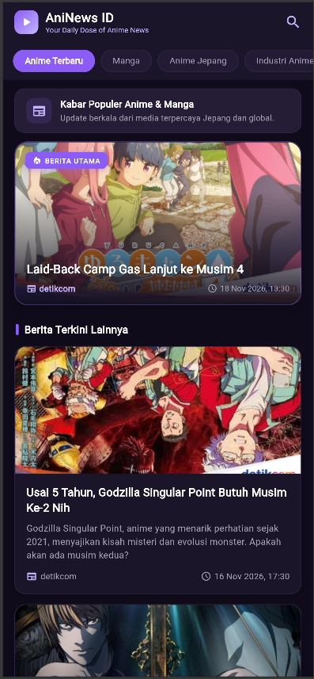
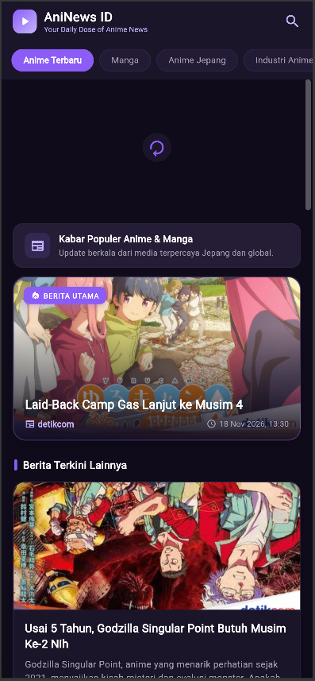
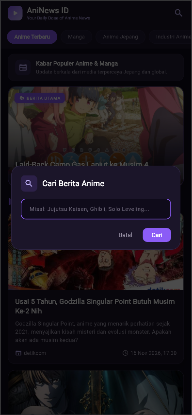
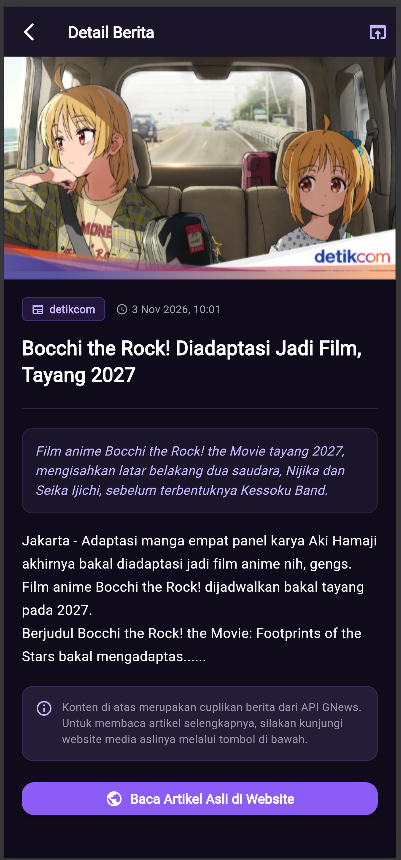
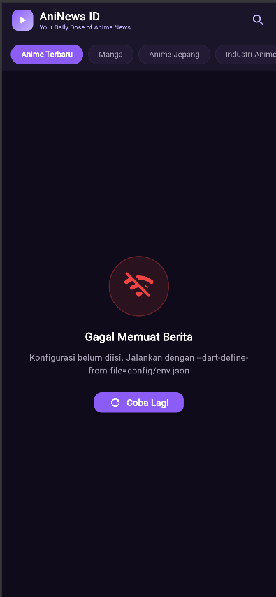
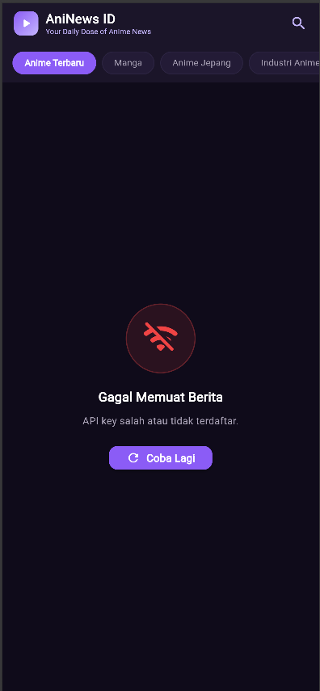
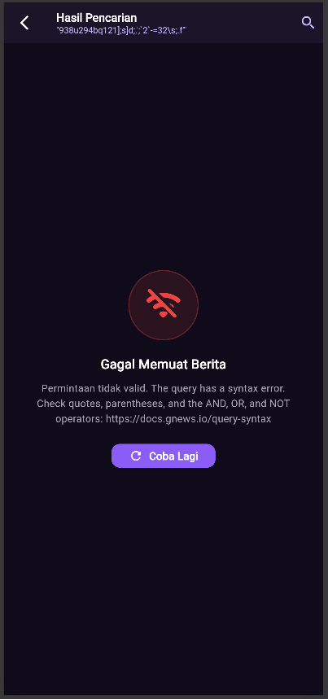
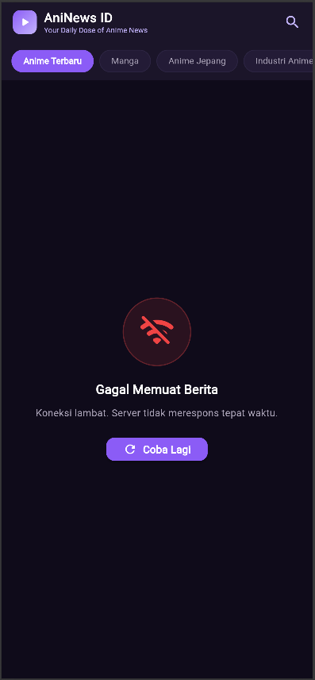

# 🎌 AniNews ID – Anime News Application

<p align="center">
  <strong>Your Daily Dose of Anime News.</strong><br>
  Aplikasi mobile berita seputar anime, manga, industri animasi Jepang, dan perkembangan budaya populer Jepang berbasis Flutter, GNews REST API, FutureBuilder, dan API Error Handling.
</p>

<p align="center">
  
  
  
  
  
</p>

---

## 📑 Daftar Isi
1. [Tentang Aplikasi](#-tentang-aplikasi)
2. [Fitur Utama & Screenshot Antarmuka](#-fitur-utama--screenshot-antarmuka)
3. [Bukti Pengujian Error Handling (ApiException)](#-bukti-pengujian-error-handling-apiexception)
4. [Arsitektur & Konsep Teknis](#-arsitektur--konsep-teknis)
5. [Panduan Instalasi & Menjalankan Aplikasi](#-panduan-instalasi--menjalankan-aplikasi)
6. [Struktur Folder](#-struktur-folder)

---

## 📱 Tentang Aplikasi

**AniNews ID** dibangun untuk memenuhi tugas mata kuliah **Pemrograman Mobile** berdasarkan modul **Topic 11: FutureBuilder, News App & Error Handling API di Flutter** (Dosen Pengampu: Rafi’e, M.Kom).

Aplikasi ini menyajikan berita anime terkini dalam Bahasa Indonesia yang diambil secara langsung melalui **GNews API v4**. Tampilan dirancang dengan tema **Modern Dark Mode** bernuansa editorial anime (perpaduan warna hitam midnight `#0F0B1A`, kartu gelap `#1B1529`, ungu aksen `#8B5CF6`, dan lavender `#C4B5FD`).

---

## 🌟 Fitur Utama & Screenshot Antarmuka

Berikut adalah tampilan fitur-fitur utama yang telah diimplementasikan secara penuh:

### 1. Halaman Beranda & Kategori (Home Page)
Menampilkan header sambutan, horizontal category chips (*Anime Terbaru*, *Manga*, *Anime Jepang*, *Industri Anime*), *Featured News* (berita utama dengan visual besar & gradient overlay), serta daftar berita terkini (*ArticleCard*).

<p align="center">
  
  <br>
  <em>Tampilan Beranda AniNews ID dengan Kategori Chips dan Berita Utama</em>
</p>

---

### 2. Fitur Pull-to-Refresh
Memungkinkan pengguna memperbarui berita kapan saja dengan menarik layar ke bawah (`RefreshIndicator`). Saat proses refresh berjalan, aplikasi membuat `Future` baru dan secara otomatis memperbarui cache kategori aktif.

<p align="center">
  
  <br>
  <em>Indikator Refresh saat Pengguna Menarik Layar ke Bawah</em>
</p>

---

### 3. Dialog Pencarian Berita (Search Dialog)
Tersedia tombol ikon pencarian di AppBar yang membuka dialog pencarian dengan input kata kunci kustom, tombol *Cari*, tombol *Batal*, serta validasi agar kata kunci tidak boleh kosong.

<p align="center">
  
  <br>
  <em>Dialog Input Pencarian Kata Kunci Berita Anime</em>
</p>

---

### 4. Halaman Hasil Pencarian (Search Results Page)
Hasil pencarian ditampilkan pada halaman terpisah menggunakan `FutureBuilder`. Halaman ini menginformasikan kata kunci yang dicari, counter jumlah berita yang ditemukan, dan menangani 4 state secara mandiri.

<p align="center">
  
  <br>
  <em>Halaman Hasil Pencarian Berdasarkan Kata Kunci</em>
</p>

---

### 5. Halaman Detail Berita (Detail View)
Ketika salah satu berita ditekan, pengguna diarahkan ke halaman detail yang menyajikan foto resolusi penuh, sumber penerbit, tanggal rilis terformat bahasa Indonesia, ringkasan, isi konten, serta tombol **"Baca Artikel Asli di Website"** yang terhubung langsung ke browser melalui `url_launcher`. Data artikel dikirim via `Get.arguments` sehingga tidak memakan kuota request API tambahan.

<p align="center">
  
  <br>
  <em>Halaman Detail Berita & Integrasi Pembaca ke Sumber Asli</em>
</p>

---

## 🛡 Bukti Pengujian Error Handling (ApiException)

Sesuai rubrik penilaian Topic 11, seluruh kegagalan jaringan dan respon server ditangkap oleh kelas terpusat `ApiException` dan ditampilkan melalui widget `ErrorView` yang dilengkapi tombol interaktif **"Coba Lagi"**:

| Skenario Error | Penjelasan & Bukti Screenshot |
|---|---|
| **1. Konfigurasi / API Key Belum Diisi** | Terjadi saat aplikasi dijalankan tanpa argumen `--dart-define-from-file` atau nilai `GNEWS_API_KEY` kosong.<br><br> |
| **2. API Key Salah / Tidak Terdaftar (401)** | Terjadi ketika API key yang digunakan salah atau tidak dikenali oleh server GNews.<br><br> |
| **3. Format Sintaks / Permintaan Tidak Valid (400)** | Terjadi saat format API key bukan hex 32 karakter atau parameter query tidak valid.<br><br> |
| **4. Rate Limit / Terlalu Cepat (429)** | Terjadi saat pengguna melakukan request lebih dari 1 kali dalam 1 detik (batasan paket Free GNews).<br><br> |
| **5. Koneksi Lambat / Timeout** | Terjadi saat koneksi internet lambat sehingga server melebihi batas waktu tunggu respons.<br><br> |

---

## ⚙ Arsitektur & Konsep Teknis

### 1. Empat State FutureBuilder
Seluruh tampilan data asynchronous ditangani menggunakan `FutureBuilder` dengan urutan snapshot:
1. **Loading State** (`snapshot.connectionState != ConnectionState.done`): Menampilkan animasi `CircularProgressIndicator`.
2. **Error State** (`snapshot.hasError`): Menampilkan `ErrorView` berisi pesan dari `ApiException` dan tombol **Coba Lagi**.
3. **Empty State** (`articles.isEmpty`): Menampilkan `EmptyView` jika API sukses tetapi tidak ada berita yang sesuai (bukan error).
4. **Data State**: Menampilkan feed artikel berita yang dapat di-scroll.

> **Pencegahan Jebakan**: Objek `Future` disimpan di dalam `State` (`late Future<List<ArticleModel>> _futureNews`) dan diinisialisasi pada `initState()`, **bukan** dibuat di dalam method `build()`.

### 2. Caching Kategori (`Map<String, Future<List<ArticleModel>>>`)
Untuk menghemat kuota GNews Free (100 req/hari), request kategori disimpan ke dalam Map. Saat berpindah kategori dan kembali lagi, aplikasi mengambil Future dari cache tanpa memicu panggilan API baru. Cache hanya diperbarui saat pengguna melakukan *pull-to-refresh* atau menekan tombol *Coba Lagi*.

### 3. Keamanan & Sensor API Key
- API key dibaca melalui `String.fromEnvironment('GNEWS_API_KEY')`.
- File rahasia disimpan di `config/env.json` yang terdaftar dalam `.gitignore`.
- Fungsi `Env.samarkan(...)` otomatis menyensor string key menjadi format `apikey=***` pada log konsol maupun pesan error.

---

## 🚀 Panduan Instalasi & Menjalankan Aplikasi

### 1. Klon Repositori & Masuk Folder
```bash
git clone https://github.com/username/aninews_id.git
cd aninews_id
```

### 2. Konfigurasi API Key
Salin berkas `config/env.example.json` menjadi `config/env.json`:
```bash
cp config/env.example.json config/env.json
```
Buka file `config/env.json` dan masukkan API key GNews Anda:
```json
{
  "GNEWS_BASE_URL": "https://gnews.io/api/v4",
  "GNEWS_API_KEY": "masukkan_api_key_gnews_anda"
}
```

### 3. Unduh Dependensi
```bash
flutter pub get
```

### 4. Jalankan Aplikasi
- **Di Google Chrome (Web):**
  ```bash
  flutter run -d chrome --dart-define-from-file=config/env.json
  ```
- **Di Emulator / Device Android:**
  ```bash
  flutter run -d android --dart-define-from-file=config/env.json
  ```
- **Di Windows Desktop:**
  ```bash
  flutter run -d windows --dart-define-from-file=config/env.json
  ```

### 5. Jalankan Pengujian Otomatis
```bash
flutter test
flutter analyze
```

---

## 📂 Struktur Folder

```
aninews_id/
├── config/
│   ├── env.example.json            # Template konfigurasi URL & API Key
│   └── env.json                    # Konfigurasi lokal riil (.gitignore)
├── screenshots_project/            # Koleksi screenshot fitur dan pengujian error
│   ├── ss_beranda.png
│   ├── ss_reload.png
│   ├── ss_search.png
│   ├── ss_hasil_search.png
│   ├── ss_berita.png
│   ├── err_konfigurasi.png
│   ├── err_salah_api.png
│   ├── err_invalid_syntaks.png
│   ├── err_terlalu_cepat.png
│   └── err_koneksi_lambat.png
├── lib/
│   ├── main.dart                   # Entry point aplikasi
│   ├── config/env.dart             # Pembaca environment & sensor API key
│   ├── models/                     # ArticleModel & NewsResponseModel
│   ├── services/                   # NewsApiService (Dio) & ApiException
│   ├── views/                      # HomeView, SearchView, DetailView
│   ├── widgets/                    # ArticleCard, FeaturedNewsCard, NewsImage, ErrorView, EmptyView, SearchDialog
│   ├── routes/                     # AppPages & AppRoutes (GetX Routing)
│   └── utils/                      # AppColors & DateFormatter (id_ID)
├── test/widget_test.dart           # Rangkaian pengujian unit test & widget smoke test
└── README.md                       # Dokumentasi utama proyek
```

---

<p align="center">
  Dibuat dengan ❤️ untuk Tugas Praktikum Pemrograman Mobile (Topic 11)
</p>
