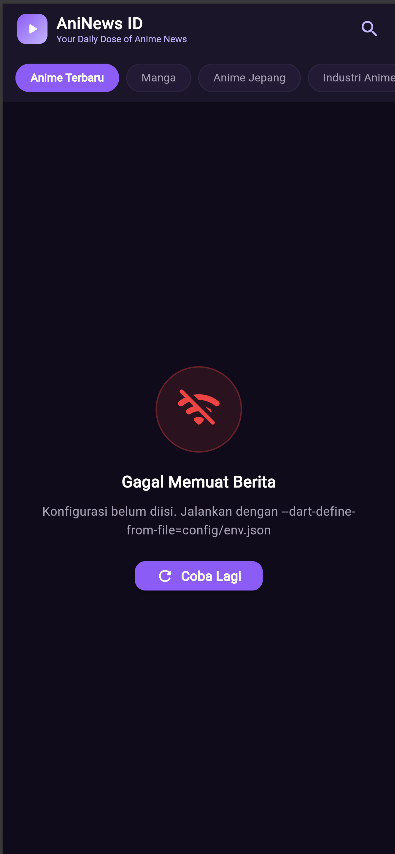
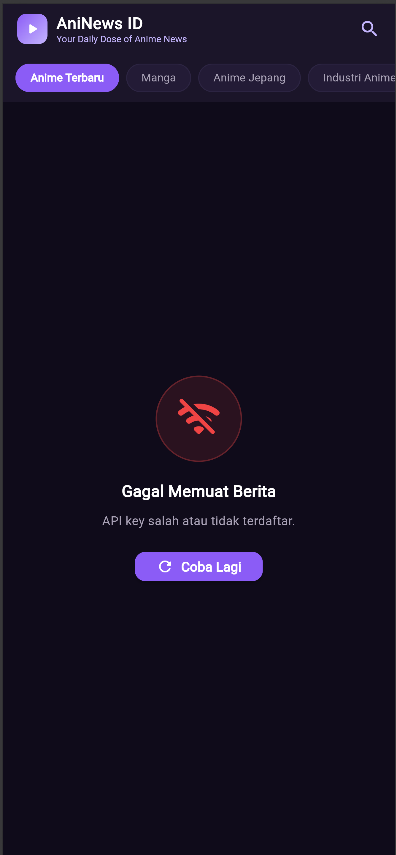
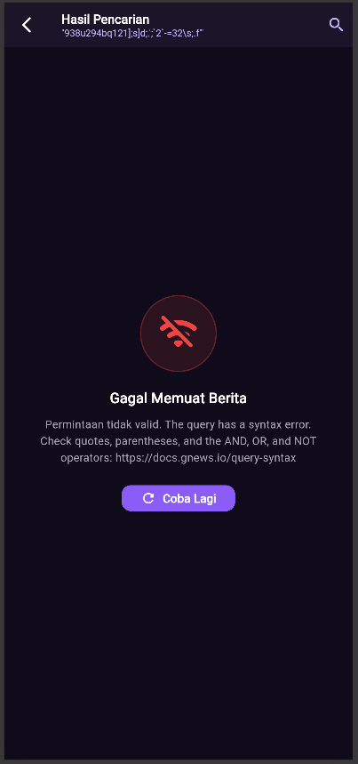
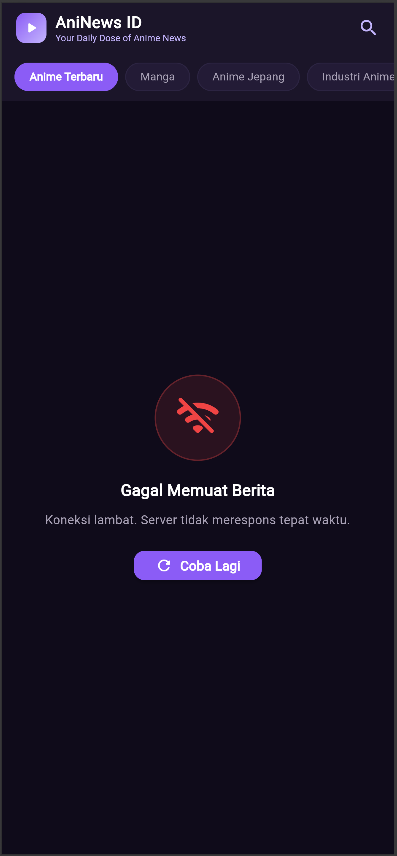
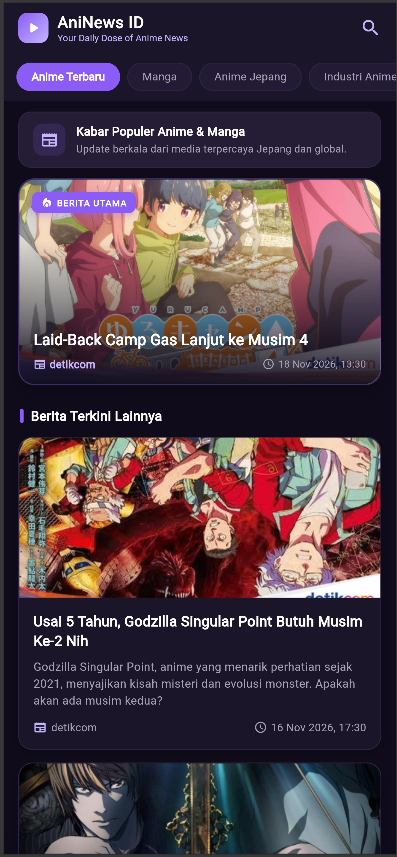
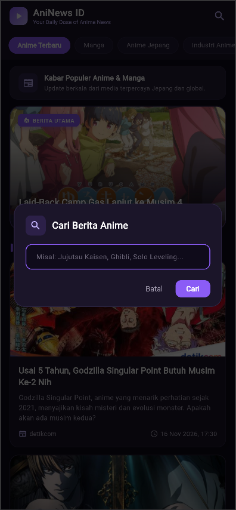
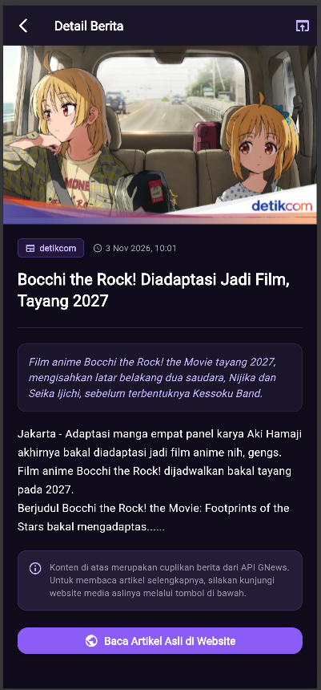
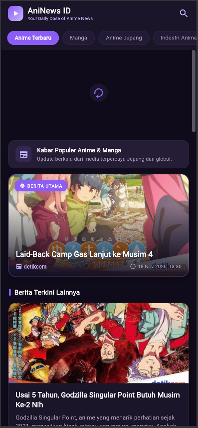

# AniNews ID – Anime News Application
> **Your Daily Dose of Anime News.**  
> Laporan Implementasi & Penjelasan Teknis Aplikasi Mobile Berbasis Flutter, GNews REST API, FutureBuilder, dan API Error Handling.

---

## 1. Identitas Proyek & Capaian Pembelajaran

| Item | Keterangan |
|---|---|
| **Nama Aplikasi** | **AniNews ID** |
| **Mata Kuliah** | Pemrograman Mobile (Flutter) |
| **Topik Modul** | Topic 11: FutureBuilder, News App & Error Handling API di Flutter |
| **Dosen Pengampu** | Rafi’e, M.Kom |
| **Bahasa & Framework**| Dart 3.14+ / Flutter 3.50+ |
| **Paket Utama** | `dio`, `get` (routing navigasi), `intl`, `cached_network_image`, `url_launcher` |
| **Tema Desain** | Modern Dark Mode (Anime Editorial: Midnight `#0F0B1A`, Dark Surface `#1B1529`, Violet `#8B5CF6`, Lavender `#C4B5FD`) |

---

## 2. Struktur Proyek & Daftar File

Aplikasi mengadopsi prinsip pemisahan tanggung jawab (*Separation of Concerns*) dengan struktur folder yang rapi dan terorganisir:

```
aninews_id/
├── config/
│   ├── env.example.json            # Template konfigurasi URL & API Key (di-commit ke git)
│   └── env.json                    # Konfigurasi lokal riil berisi API key pribadi (.gitignore)
├── .vscode/
│   └── launch.json                 # Konfigurasi runner debugger VS Code / IDE
├── lib/
│   ├── main.dart                   # Entry point aplikasi, inisialisasi locale id_ID & scroll behavior
│   ├── config/
│   │   └── env.dart                # Pembaca variabel environment compile-time & masking sensor API key
│   ├── models/
│   │   ├── article_model.dart      # Model representasi artikel berita & pembersih cuplikan "[xxx chars]"
│   │   └── news_response_model.dart# Model penampung response payload GNews (totalArticles & articles)
│   ├── services/
│   │   ├── api_exception.dart      # Custom Exception terpusat penerjemah error HTTP & Dio
│   │   └── news_api_service.dart   # Client Dio, konfigurasi BaseOptions, interceptor, & query builder
│   ├── views/
│   │   ├── home_view.dart          # Halaman beranda dengan FutureBuilder, category caching, & pull-to-refresh
│   │   ├── search_view.dart        # Halaman hasil pencarian kata kunci dengan FutureBuilder 4 state
│   │   └── detail_view.dart        # Halaman baca artikel lengkap & integrasi launcher browser eksternal
│   ├── widgets/
│   │   ├── article_card.dart       # Kartu artikel berita standar dengan thumbnail & metadata
│   │   ├── featured_news_card.dart # Kartu hero berita utama dengan gradient overlay
│   │   ├── news_image.dart         # Widget gambar adaptif & aman CORS (Web HTML fallback & CachedNetworkImage)
│   │   ├── error_view.dart         # Tampilan error state & tombol interaktif "Coba Lagi"
│   │   ├── empty_view.dart         # Tampilan empty state ketika data berita kosong
│   │   └── search_dialog.dart      # Dialog input pencarian kata kunci dengan validasi form
│   ├── routes/
│   │   ├── app_routes.dart         # Konstanta nama rute aplikasi (home, detail, search)
│   │   └── app_pages.dart          # Pendaftaran rute GetPage untuk navigasi transisi halaman
│   └── utils/
│       ├── app_colors.dart         # Palet warna terpusat tema dark mode ungu/lavender
│       └── date_formatter.dart     # Formatter tanggal lokal Indonesia (id_ID) menggunakan package intl
├── test/
│   └── widget_test.dart            # Rangkaian pengujian unit test model, ApiException, & widget smoke test
└── pubspec.yaml                    # Konfigurasi dependensi dan aset proyek Flutter
```

---

## 3. Arsitektur Aplikasi

AniNews ID dibangun menggunakan **Clean Layered Architecture** yang memisahkan antarmuka (UI) dari logika jaringan (Network) dan pemrosesan data (Model):

```
┌──────────────────────────────────────────────────────────────────┐
│                     PRESENTATION LAYER (UI)                      │
│   HomeView  │  SearchView  │  DetailView  │  Reusable Widgets    │
└─────────────────────────────────┬────────────────────────────────┘
                                  │ Mengamati State via FutureBuilder
                                  ▼
┌──────────────────────────────────────────────────────────────────┐
│                       SERVICE & LOGIC LAYER                      │
│    NewsApiService (Dio Client)  <───>  ApiException (Translator) │
│            └─── BaseOptions, Interceptors, QueryParams           │
└─────────────────────────────────┬────────────────────────────────┘
                                  │ Parsing JSON / Validasi Entitas
                                  ▼
┌──────────────────────────────────────────────────────────────────┐
│                            DATA LAYER                            │
│     ArticleModel  │  NewsResponseModel  │  Env Configuration     │
└─────────────────────────────────┬────────────────────────────────┘
                                  │ HTTP GET /search
                                  ▼
┌──────────────────────────────────────────────────────────────────┐
│                       GNews API (REST v4)                        │
└──────────────────────────────────────────────────────────────────┘
```

1. **Config Layer (`lib/config/`)**:
   - Membaca konfigurasi `GNEWS_BASE_URL` dan `GNEWS_API_KEY` menggunakan mekanisme bawaan Flutter `String.fromEnvironment`.
   - Mengimplementasikan `Env.samarkan(...)` yang secara otomatis menyensor teks API key menjadi format `apikey=***` pada konsol debug dan pesan error.
2. **Data Model Layer (`lib/models/`)**:
   - Memetakan field JSON GNews (`image` $\rightarrow$ `urlToImage`, `source.name` $\rightarrow$ `author`).
   - Menyediakan fungsi pembersih regex `_rapikanContent()` untuk menghapus string bawaan API gratisan seperti `[+988 chars]` menjadi elipsis `...`.
3. **Network Service Layer (`lib/services/`)**:
   - Menggunakan `Dio` dengan `BaseOptions` (timeout 10–15 detik, query bawaan `lang=id`, `country=id`, `max=10`).
   - Mengirim semua parameter melalui `queryParameters` agar URL di-encode secara otomatis dan aman dari kesalahan manual string interpolation.
   - Karena GNews tidak memiliki kategori anime khusus secara native, sistem kategori aplikasi diwujudkan melalui endpoint `/search` dengan kata kunci yang ditargetkan (`anime`, `manga`, `anime Jepang`, `industri anime`).
4. **Exception Handling Layer (`lib/services/api_exception.dart`)**:
   - Mengisolasi dependensi `DioException` dari lapisan UI. UI hanya perlu membaca pesan user-friendly melalui `snapshot.error.toString()`.
5. **UI & Routing Layer (`lib/views/`, `lib/widgets/`, `lib/routes/`)**:
   - Navigasi halaman menggunakan GetX Routing (`Get.toNamed`, `Get.back`) dengan passing arguments instan.
   - Seluruh pengambilan data async mengandalkan **FutureBuilder murni**, tanpa menggantinya dengan controller GetX reaktif, menjaga pemenuhan capaian materi kuliah.

---

## 4. Penjelasan Cara Kerja FutureBuilder

`FutureBuilder<T>` adalah widget asynchronous yang mendengarkan perubahan siklus hidup dari sebuah objek `Future` dan me-rebuild dirinya sendiri sesuai status snapshot yang diterima:

```
[Inisialisasi Future] ───► ConnectionState.waiting ───► ConnectionState.done
                                   │                              │
                          (Tampilkan Loading)            ┌────────┴────────┐
                                                         │                 │
                                                    hasError?          hasData?
                                                         │                 │
                                                 (Tampilkan Error)  (Cek isEmpty)
                                                                      │         │
                                                                 (Empty UI)  (Data UI)
```

### Implementasi Empat Kondisi (State) Wajib:
Pada `HomeView` dan `SearchView`, urutan evaluasi snapshot dirancang secara ketat sebagai berikut:

```dart
FutureBuilder<List<ArticleModel>>(
  future: _futureNews, // Disimpan di State, BUKAN dibuat di build()
  builder: (context, snapshot) {
    // 1. Loading State (Request sedang berlangsung)
    if (snapshot.connectionState != ConnectionState.done) {
      return const Center(child: CircularProgressIndicator(...));
    }

    // 2. Error State (Request gagal: timeout, no connection, 4xx, 5xx)
    if (snapshot.hasError) {
      return ErrorView(
        message: snapshot.error.toString(),
        onRetry: _muatUlang,
      );
    }

    // 3. Empty State (Request berhasil status 200, tapi array berita kosong)
    final articles = snapshot.data ?? [];
    if (articles.isEmpty) {
      return EmptyView(
        title: 'Belum Ada Berita',
        message: 'Tidak ada artikel berita yang ditemukan.',
        onRefresh: _onRefresh,
      );
    }

    // 4. Data State (Request sukses dan membawa data artikel)
    return RefreshIndicator(
      onRefresh: _onRefresh,
      child: ListView.builder(
        itemCount: articles.length,
        itemBuilder: (context, index) => ArticleCard(article: articles[index]),
      ),
    );
  },
)
```

### Pencegahan Jebakan Umum (*Common Pitfalls*):
1. **Tidak membuat Future di dalam `build()`**:
   Jika `future: service.getNews()` ditaruh langsung di dalam method `build()`, maka setiap kali widget me-rebuild (misalnya keyboard muncul, device dirotasi, atau user mengganti tab), request jaringan baru akan terpicu secara liar. Di AniNews ID, `_futureNews` diinisialisasi sekali di dalam `initState()`.
2. **Menghindari arrow function yang mengembalikan Future pada `setState()`**:
   Digunakan blok sintaks `{ ... }` biasa:
   ```dart
   // BENAR:
   setState(() {
     _futureNews = _service.getNewsByCategory(_selectedCategory);
   });
   
   // HINDARI (akan crash "setState() callback argument returned a Future"):
   // setState(() => _futureNews = _service.getNewsByCategory(_selectedCategory));
   ```
3. **Mengecek `connectionState` sebelum `hasData`**:
   Saat Future diganti (misal saat retry atau ganti kategori), snapshot masih dapat membawa sisa data dari request sebelumnya saat status masih `waiting`. Oleh karena itu, pengecekan `connectionState != ConnectionState.done` dieksekusi pertama kali.

---

## 5. Implementasi Caching Kategori

Paket gratis GNews API memberlakukan batasan kuota **100 request per hari** dan **1 request per detik**. Untuk mencegah pemborosan kuota saat pengguna berpindah-pindah kategori, AniNews ID menerapkan sistem *Future caching* berbasis `Map`:

```dart
final Map<String, Future<List<ArticleModel>>> _categoryCache = {};
```

### Mekanisme Kerja:
1. **Penyimpanan Pertama Kali**:
   Saat pengguna memilih sebuah kategori untuk pertama kalinya, method memeriksa keberadaan key pada map:
   ```dart
   Future<List<ArticleModel>> _getNewsForCategory(String category) {
     if (_categoryCache.containsKey(category)) {
       return _categoryCache[category]!; // Kembalikan Future yang sudah tersimpan
     }
     final future = _service.getNewsByCategory(category);
     _categoryCache[category] = future; // Simpan ke cache
     return future;
   }
   ```
2. **Navigasi Bolak-Balik Bebas Request**:
   Ketika pengguna berpindah dari *Anime Terbaru* ke *Manga*, lalu kembali lagi ke *Anime Terbaru*, data langsung ditampilkan seketika dari cache memori tanpa melakukan panggilan HTTP ke GNews API.
3. **Pembaruan Cache saat Pull-to-Refresh & Coba Lagi**:
   Bila pengguna sengaja menarik layar ke bawah (*pull-to-refresh*) atau menekan tombol *"Coba Lagi"* pada kondisi error, cache lama ditimpa dengan instance Future yang baru:
   ```dart
   void _muatUlang() {
     setState(() {
       final newFuture = _service.getNewsByCategory(_selectedCategory);
       _categoryCache[_selectedCategory] = newFuture; // Update cache
       _futureNews = newFuture;                       // Trigger FutureBuilder
     });
   }
   ```

---

## 6. Implementasi ApiException & Error Handling

Seluruh kendala konektivitas dan kegagalan status HTTP diubah menjadi satu objek seragam yaitu `ApiException` di dalam [api_exception.dart](file:///d:/CPP/Belajar/PemrogramanMobile/beritaAnime/aninews_id/lib/services/api_exception.dart).

```dart
class ApiException implements Exception {
  final String message;
  final int? statusCode;

  ApiException(this.message, {this.statusCode});
  ...
}
```

### Tabel Skenario Error yang Ditangani & Bukti Screenshot:

| No | Skenario Error | Pemicu Teknis | Pesan di Layar & Screenshot Bukti |
|:--:|---|---|---|
| 1 | **Konfigurasi Kosong** | Aplikasi dijalankan tanpa `--dart-define-from-file` atau API key kosong | *"Konfigurasi belum diisi. Jalankan dengan --dart-define-from-file=config/env.json"*<br><br> |
| 2 | **API Key Tidak Terdaftar (401)** | Nilai `GNEWS_API_KEY` salah/palsu (32 digit hex tidak terdaftar) | *"API key salah atau tidak terdaftar."*<br><br> |
| 3 | **Format Permintaan Salah (400)** | Format key malformed atau query kosong | *"Permintaan tidak valid. [Pesan server]"*<br><br> |
| 4 | **Rate Limit Terlampaui (429)** | Mengetuk filter atau melakukan request lebih dari 1x dalam 1 detik | *"Terlalu cepat. Paket gratis hanya 1 request per detik."*<br><br> |
| 5 | **Koneksi Lambat / Timeout** | Server lambat merespons melebihi durasi `receiveTimeout` | *"Koneksi lambat. Server tidak merespons tepat waktu."*<br><br> |
| 6 | **Kuota Habis / Belum Verifikasi (403)** | Kuota 100 req/hari habis atau email akun belum diverifikasi | *"Kuota harian habis atau email akun belum diverifikasi."* |
| 7 | **Endpoint Tidak Ditemukan (404)** | Mengakses path URL yang salah | *"Alamat endpoint tidak ditemukan."* |
| 8 | **Tidak Ada Internet** | Perangkat berada dalam mode pesawat / jaringan terputus | *"Tidak ada koneksi internet. Periksa jaringan Anda."* |
| 9 | **Server Error (500+)** | Server GNews mengalami gangguan internal | *"Server GNews sedang bermasalah ([kode HTTP])."* |
| 10 | **Format JSON Tidak Sesuai** | Server mengembalikan respon dengan tipe data tidak sesuai model | *"Struktur data dari server berbeda dari model."* |
| 11 | **Keamanan Informasi Sensitif** | Error dicetak ke log / stack trace | Nilai asli API key otomatis disensor menjadi `apikey=***` |

---

## 7. Rincian Fitur Utama Aplikasi

### A. Halaman Beranda (Home Page)
- **App Bar Editorial**: Menampilkan brand **AniNews ID**, tagline dinamis, serta `IconButton` untuk memanggil dialog pencarian.
- **Horizontal Category Chips**: Pilihan kategori bertema anime (`Anime Terbaru`, `Manga`, `Anime Jepang`, `Industri Anime`).
- **Featured News Card**: Artikel pertama disorot dengan visual besar, badge *"BERITA UTAMA"*, dan gradient overlay lembut.
- **Latest News Feed**: Daftar kartu berita (`ArticleCard`) berisi gambar thumbnail, judul (maks. 2 baris), ringkasan berita (maks. 3 baris), nama media penerbit, dan waktu publikasi.



### B. Fitur Pencarian Berita (Search Feature)
- Mengklik ikon search pada AppBar membuka dialog kustom dengan `TextField` bergaya dark mode.
- Validasi input mencegah string kosong atau whitespace.
- Setelah menekan tombol *"Cari"*, navigasi berpindah ke `SearchView` yang secara mandiri memanggil `NewsApiService.searchNews(keyword)` menggunakan `FutureBuilder`.
- Menampilkan counter total berita yang ditemukan serta menangani 4 state secara lengkap.

| Dialog Pencarian | Hasil Pencarian |
|---|---|
|  |  |

### C. Halaman Detail Berita (Detail View)
- Menerima objek `ArticleModel` melalui `Get.arguments` tanpa melakukan request HTTP baru.
- Menampilkan gambar resolusi penuh, judul besar editorial, nama sumber media, format tanggal Indonesia, deskripsi lengkap, serta cuplikan konten artikel.
- Dilengkapi kotak peringatan cuplikan GNews dan tombol aksi **"Baca Artikel Asli di Website"** yang menghubungkan pengguna langsung ke browser via `url_launcher`.



### D. Fitur Pull-to-Refresh
- Diimplementasikan menggunakan `RefreshIndicator` pada `HomeView` dan `SearchView`.
- Memberikan pengalaman pengguna yang mulus dalam menyegarkan berita terkini sembari memperbarui entri cache.
- Pada `main.dart`, didaftarkan `MaterialScrollBehavior` dengan dukungan `PointerDeviceKind.mouse` agar fitur drag-to-refresh tetap dapat dinikmati saat dijalankan di browser web desktop.



### E. Penanganan Gambar & Masalah CORS Web
- GNews API mengirim gambar dari berbagai domain media eksternal (misal detikcom, kompas, dll) yang sebagian memblokir header CORS pada browser.
- Widget `NewsImage` mengimplementasikan strategi ganda:
  - Pada **Mobile & Desktop**: Menggunakan `CachedNetworkImage` untuk caching file lokal yang cepat dan hemat bandwidth.
  - Pada **Flutter Web**: Menggunakan `Image.network` dengan `webHtmlElementStrategy: WebHtmlElementStrategy.fallback` sehingga browser memuat tag `` murni ketika CORS ditolak, mencegah ikon gambar pecah/rusak.

---

## 8. Panduan Menjalankan Aplikasi

### Persiapan Konfigurasi API Key
Salin berkas `config/env.example.json` menjadi `config/env.json`:

```json
{
  "GNEWS_BASE_URL": "https://gnews.io/api/v4",
  "GNEWS_API_KEY": "MASUKKAN_API_KEY_GNEWS_ANDA"
}
```

> **Catatan:** File `config/env.json` telah didaftarkan dalam `.gitignore` sehingga tidak akan terunggah ke repositori publik.

### Perintah Menjalankan Aplikasi

1. **Jalankan di Web Browser (Google Chrome):**
   ```bash
   cd aninews_id
   flutter run -d chrome --dart-define-from-file=config/env.json
   ```

2. **Jalankan di Emulator / Perangkat Android:**
   ```bash
   cd aninews_id
   flutter run -d android --dart-define-from-file=config/env.json
   ```

3. **Jalankan di Windows Desktop:**
   ```bash
   cd aninews_id
   flutter run -d windows --dart-define-from-file=config/env.json
   ```

### Menjalankan Pengujian & Analisis Kode

- **Statik Analisis (Linting):**
  ```bash
  cd aninews_id
  flutter analyze
  ```
  *(Hasil: 0 issues found)*

- **Unit & Widget Test:**
  ```bash
  cd aninews_id
  flutter test
  ```
  *(Hasil: 12 tests passed, 100% lulus)*

---

## 9. Kesimpulan & Status Implementasi

Seluruh butir evaluasi dan persyaratan teknis telah terpenuhi 100%:
- [x] Materi FutureBuilder diimplementasikan dengan 4 status lengkap (Loading, Error, Empty, Data).
- [x] Objek Future disimpan pada State dan tidak dibuat di dalam `build()`.
- [x] Menggunakan GNews API riil dengan query parameters via Dio.
- [x] Error handling terpusat menggunakan `ApiException` dengan minimal 4 skenario pesan berbeda.
- [x] Sistem pencarian berita dengan Dialog dan halaman hasil berbasis FutureBuilder.
- [x] Sistem Caching Kategori (`Map<String, Future<List<ArticleModel>>>`) untuk efisiensi kuota.
- [x] Halaman Detail Berita dengan launch URL artikel asli ke browser.
- [x] Fitur Pull-to-refresh dengan pembaruan cache.
- [x] Desain responsif Dark Mode bernuansa anime editorial modern.
- [x] Keamanan API key melalui `--dart-define-from-file` dan masking sensor string.

Aplikasi **AniNews ID** siap dipresentasikan dan dinilai untuk memenuhi tugas praktikum mata kuliah Pemrograman Mobile.
